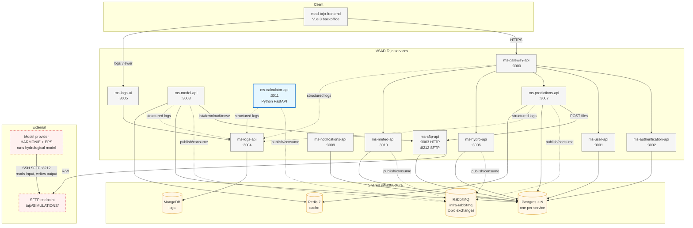
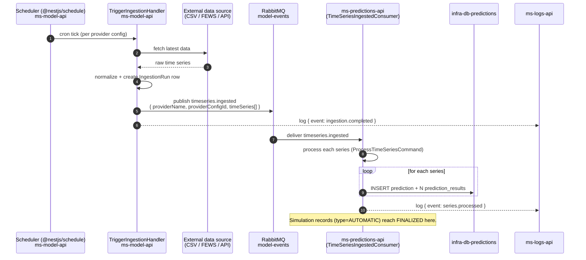
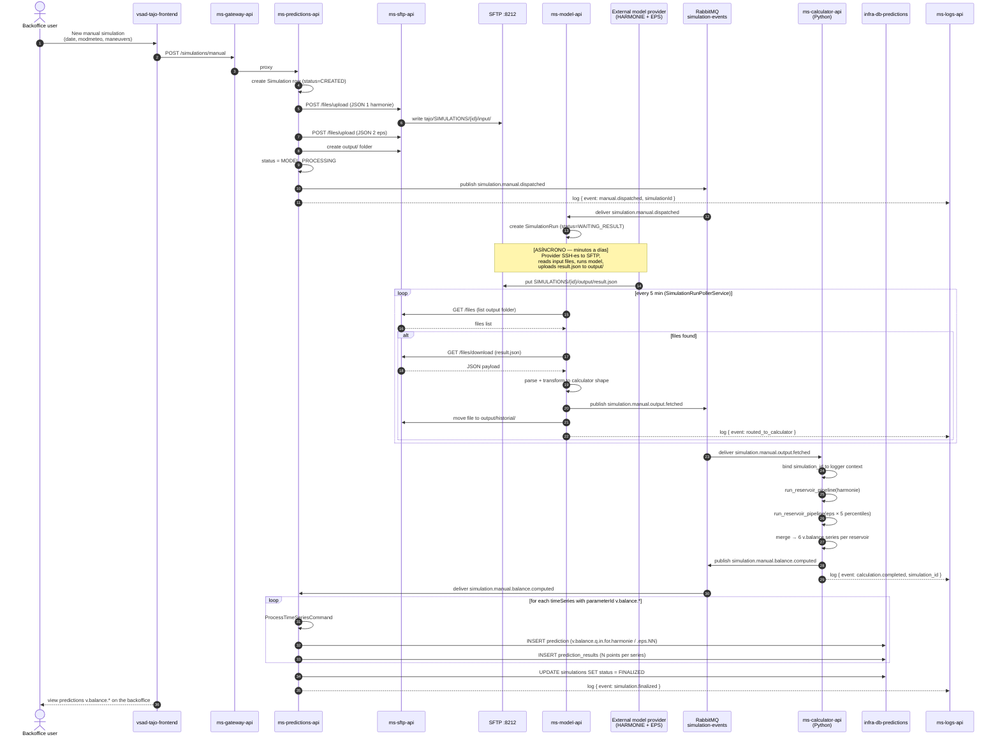

# Tajo Monorepo

Source of truth for the VSAD Tajo platform. Each subdirectory is mirrored to a standalone repo on every push to `main` — the standalone repos are what Jenkins watches and deploys to the Hetzner VM.

## Services

| Subdir | Standalone repo | Deploy |
|---|---|---|
| `ms-gateway-api/` | [VSADTajo/ms-gateway-api](https://github.com/VSADTajo/ms-gateway-api) | Jenkins → Hetzner |
| `ms-user-api/` | [VSADTajo/ms-user-api](https://github.com/VSADTajo/ms-user-api) | Jenkins → Hetzner |
| `ms-authentication-api/` | [VSADTajo/ms-authentication-api](https://github.com/VSADTajo/ms-authentication-api) | Jenkins → Hetzner |
| `ms-sftp-api/` | [VSADTajo/ms-sftp-api](https://github.com/VSADTajo/ms-sftp-api) | Jenkins → Hetzner |
| `ms-logs-api/` | [VSADTajo/ms-logs-api](https://github.com/VSADTajo/ms-logs-api) | Jenkins → Hetzner |
| `ms-hydro-api/` | [VSADTajo/ms-hydro-api](https://github.com/VSADTajo/ms-hydro-api) | Jenkins → Hetzner |
| `ms-predictions-api/` | [VSADTajo/ms-predictions-api](https://github.com/VSADTajo/ms-predictions-api) | Jenkins → Hetzner |
| `ms-model-api/` | [VSADTajo/ms-model-api](https://github.com/VSADTajo/ms-model-api) | Jenkins → Hetzner |
| `ms-notifications-api/` | [VSADTajo/ms-notifications-api](https://github.com/VSADTajo/ms-notifications-api) | Jenkins → Hetzner |
| `ms-meteo-api/` | [VSADTajo/ms-meteo-api](https://github.com/VSADTajo/ms-meteo-api) | Jenkins → Hetzner |
| `ms-calculator-api/` | [VSADTajo/ms-calculator-api](https://github.com/VSADTajo/ms-calculator-api) | Jenkins → Hetzner (Python + FastAPI) |
| `vsad-tajo-frontend/` | [VSADTajo/vsad-tajo-frontend](https://github.com/VSADTajo/vsad-tajo-frontend) | Jenkins → Hetzner |
| `tajo-toolkit/` | [VSADTajo/tajo-toolkit](https://github.com/VSADTajo/tajo-toolkit) | Published as `github:VSADTajo/tajo-toolkit` (no deploy) |

**Not part of this monorepo**: `infra/` (docker-compose stack, lives in its own repo), `vsad_tajo_geoserver`, `tajo-gisdb-backup`.

---

## Architecture — component diagram



---

## Simulation flows

VSAD Tajo genera predicciones de volumen para los embalses del río Tajo. Hay **dos flujos** de simulación, con distinta cadencia y grado de automatización.

### Flujo 1 — Simulación **AUTOMATIC** (ingesta continua)

Corre en background sin intervención del usuario. Ingesta continua de datos meteorológicos e hidrológicos publicados por proveedores automáticos (ejemplo: series FEWS, CSV recurrentes, etc.). Es el pipeline "de siempre" — el path de proveedores automáticos NO usa `ms-calculator-api`.



**Ejemplos de este flujo en producción**: la tabla `simulations` muestra que las tipo `AUTOMATIC` se finalizan por hora (una nueva cada hora, típicamente en `HH:02:xx`).

Este flujo **no depende del calculator** — los datos ingresados ya vienen en la forma final (caudales / series meteo) y se persisten directamente como `Prediction` en la DB.

### Flujo 2 — Simulación **MANUAL** (con calculadora de balance)

Un usuario del backoffice dispara una simulación de forecast custom (con maniobras específicas). El sistema envía los inputs a un **proveedor externo del modelo hidrológico** (HARMONIE / EPS) vía SFTP; cuando el proveedor deposita el output, `ms-model-api` lo detecta y lo enruta a `ms-calculator-api` para computar el balance de volumen (`v.balance`) por embalse.



**Punto crítico**: los pasos 12 (proveedor) son **externos al monorepo**. Ver [`docs/examples/`](./docs/examples/) para el contrato completo del archivo `result.json` que el proveedor debe depositar, con un ejemplo válido.

### Feature flag

El path de calculator es controlado por la env var `USE_CALCULATOR_PIPELINE` en `ms-model-api` (Jenkinsfile).

- **`USE_CALCULATOR_PIPELINE=true`** (estado actual en prod): manual simulations van al calculator.
- **`USE_CALCULATOR_PIPELINE=false`** (fallback): el poller publica al topic legacy `timeseries.ingested` y el consumer viejo de predictions-api persiste las series crudas del proveedor. Se puede volver a este modo con un rebuild.

---

## How sync works

```
push to monorepo:main
    │
    ▼
.github/workflows/sync-subtrees.yml
    │
    ├─ Job 1: detect-changes
    │    git diff HEAD~1..HEAD → list of subdirs that changed
    │    emits a dynamic matrix with only those services
    │    (manual workflow_dispatch forces all 13)
    │
    ▼
    ├─ Job 2: sync (matrix, one parallel job per changed service)
    │    │
    │    ├─ install splitsh-lite (handles --squash subtrees;
    │    │  the built-in `git subtree split` does not)
    │    │
    │    └─ splitsh-lite --prefix=<subdir>   → split SHA
    │       git push <standalone> <SHA>:main --force
    │
    ▼
Each touched standalone repo gets main force-pushed
    │
    ▼
Jenkins multibranch pipeline on each standalone fires its deploy as today
```

The monorepo is the **source of truth**. Pushes directly to a standalone repo's `main` are overwritten on the next monorepo sync. Configure branch protection on each standalone to enforce this.

### Why splitsh-lite instead of `git subtree split`

The subtrees were bootstrapped with `git subtree add --squash`. The `--squash` flag drops the upstream history into a single squash-commit, which is what we want for the monorepo's log — but it also breaks the built-in `git subtree split` (it tries to rev-parse hashes that no longer exist locally and dies with `fatal: could not rev-parse split hash …`). `splitsh-lite` (the same tool Symfony / Laravel / Drupal use to split their monorepos) is a drop-in replacement that handles squashed subtrees correctly and is ~100× faster on large histories.

## Working in the monorepo

```bash
# Clone
git clone https://github.com/VSADTajo/tajo-monorepo.git
cd tajo-monorepo

# Work as usual inside any service subdir
cd ms-predictions-api
npm install
npm run start:dev

# Cross-service feature: edit multiple subdirs in a single branch + PR
```

## Pre-monorepo history

Each standalone repo carries a tag `pre-monorepo` that points to the last commit before the monorepo cut-over. Use that to inspect history that predates the monorepo, e.g.:

```bash
git clone https://github.com/VSADTajo/ms-predictions-api.git
cd ms-predictions-api
git log pre-monorepo --oneline | head -50
```

## One-time setup (already done, documented for transparency)

1. **PAT for cross-repo push**: a Personal Access Token with `repo` scope on the `VSADTajo` org is stored as the secret `SUBTREE_PUSH_TOKEN` in this repo's settings. The sync workflow uses it to push to each standalone.
2. **Bootstrap**: each subdir was added via `git subtree add --prefix=<dir> https://github.com/VSADTajo/<repo>.git main --squash`. The `--squash` keeps the monorepo log clean (one squash-commit per subtree instead of importing the full upstream history). To extract per-subdir history from the squashed monorepo, the sync workflow uses `splitsh-lite` rather than the built-in `git subtree split` — see the section above for why.
3. **`pre-monorepo` tag** was placed on each standalone before the first sync to preserve original history.

## Manual sync trigger

If sync ever needs to run outside a push event (e.g., after a freeze, or to recover from an aborted run), go to **Actions → Sync Subtrees → Run workflow**. With `workflow_dispatch`, every subdir is force-pushed regardless of whether it changed.

## What lives where

- **App code** for each service: under its subdir here.
- **Deploy pipeline (`Jenkinsfile`)**: inside each subdir, gets synced to the standalone — Jenkins keeps working unchanged.
- **Infra config (`docker-compose.yml`, `.env`)**: lives in a separate `infra` repo; this monorepo does not own it.
- **Secrets**: managed in Jenkins credentials store, never in source files.

## Documentation

- [`docs/flows/manual-simulation.md`](./docs/flows/manual-simulation.md) — flow narrado con contratos AMQP detallados.
- [`docs/examples/`](./docs/examples/) — ejemplos del archivo `result.json` que el proveedor externo debe depositar.
- [`docs/runbooks/manual-simulation-runbook.md`](./docs/runbooks/manual-simulation-runbook.md) — on-call runbook con diagnóstico de fallas comunes.
- [`docs/logging-standard.md`](./docs/logging-standard.md) — convención de logs estructurados + correlation IDs.
- [`.claude/rules/08-observability.md`](./.claude/rules/08-observability.md) — DLX + trace-id conventions.
