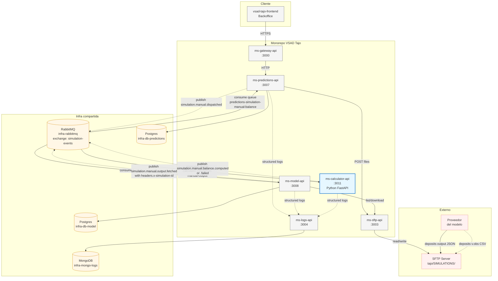
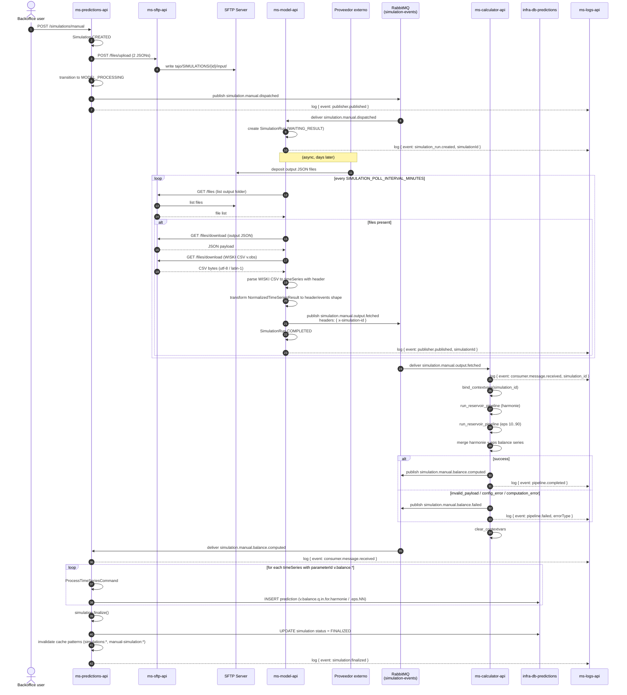

# Flujo de simulación manual con calculadora de volumen

> Estado: introducido con el team `calculator-integration` (2026-07). Feature flag `USE_CALCULATOR_PIPELINE` en `ms-model-api`.

## Contexto

El flujo de simulaciones manuales integra un nuevo microservicio (`ms-calculator-api`, Python + FastAPI) entre `ms-model-api` (fetch del output del proveedor) y `ms-predictions-api` (persistencia de predicciones). La calculadora computa el balance de volumen (`v.balance = max(0, v.obs.t0 + q.in.accumulated - q.out.accumulated)`) para cada embalse, en modo determinista (harmonie) y percentiles EPS (10/25/50/75/90).

El path automático de proveedores (`ingestion.commands.ts` de `ms-model-api` → `TimeSeriesIngestedConsumer` de `ms-predictions-api`) **NO se ve afectado** por este cambio.

## Diagramas

### Componentes



### Flujo de datos

```mermaid
flowchart LR
  A[POST /simulations/manual<br/>backoffice] --> B[Simulation CREATED<br/>ms-predictions-api]
  B --> C[Upload 2 JSON files<br/>tajo/SIMULATIONS/id/input/]
  C --> D[Publish<br/>simulation.manual.dispatched]
  D --> E[SimulationRun WAITING_RESULT<br/>ms-model-api]
  E --> F{Poll SFTP<br/>output folder<br/>every 5min}
  F -->|empty| F
  F -->|files found| G[Fetch + parse<br/>provider output]
  G --> H{USE_CALCULATOR_PIPELINE?}
  H -->|OFF legacy| L1[Publish<br/>timeseries.ingested]
  H -->|ON| I[Fetch WISKI CSV<br/>with v.obs series]
  I --> J[Transform to<br/>timeSeries with header nested]
  J --> K[Publish<br/>simulation.manual.output.fetched]
  K --> M[Run reservoir pipeline<br/>harmonie plus 5 EPS<br/>ms-calculator-api]
  M --> N{Success?}
  N -->|yes| O[Publish<br/>simulation.manual.balance.computed]
  N -->|error| P[Publish<br/>simulation.manual.balance.failed]
  O --> Q[Consumer processes<br/>each timeSeries<br/>ms-predictions-api]
  L1 --> Q
  Q --> R[ProcessTimeSeriesCommand<br/>persist Predictions]
  R --> S{All series done?}
  S -->|no| Q
  S -->|yes| T[Simulation FINALIZED<br/>invalidate cache]
  P -.->|DLQ / alert| U[On-call]

  style H fill:#fff7e6,stroke:#d48806
  style M fill:#e6f7ff,stroke:#0066cc
  style O fill:#f6ffed,stroke:#52c41a
  style P fill:#fff1f0,stroke:#cf1322
  style T fill:#f6ffed,stroke:#52c41a
```



### Secuencia end-to-end (con flag ON)



## Diagrama end-to-end

```
POST /simulations/manual  (ms-predictions-api)
  ├─ crea Simulation MANUAL (status: CREATED)
  ├─ sube 2 JSONs a SFTP: tajo/SIMULATIONS/{id}/input/tagus_{harmonie|eps}_Q_{ts}.json
  ├─ crea folder tajo/SIMULATIONS/{id}/output/
  ├─ transiciona a MODEL_PROCESSING
  └─ publica ► simulation.manual.dispatched  (exchange: simulation-events)
                            │
                            ▼
ms-model-api (SimulationDispatchedConsumerService)
  └─ registra SimulationRun (status: WAITING_RESULT)
                            │
                            ▼  (poll cada SIMULATION_POLL_INTERVAL_MINUTES, default 5min)
ms-model-api (SimulationRunPollerService + SimulationResultFetcherService)
  ├─ lista SFTP output folder — si no hay archivos, sale y reintenta
  ├─ descarga + parsea JSON del proveedor
  ├─ (SI USE_CALCULATOR_PIPELINE=true)
  │   ├─ descarga WISKI CSV desde SFTP (env var VOBS_CSV_SFTP_PATH)
  │   ├─ parsea CSV con timezone VOBS_CSV_TIMEZONE (default Europe/Madrid) → UTC
  │   ├─ transforma NormalizedTimeSeriesResult[] + WiskiTimeSeriesResult[] a shape { header, events }[]
  │   └─ publica ► simulation.manual.output.fetched  (exchange: simulation-events)
  │        AMQP headers: { x-simulation-id: <id> }
  ├─ (SI USE_CALCULATOR_PIPELINE=false — fallback legacy)
  │   └─ publica ► timeseries.ingested  (exchange: model-events)
  └─ marca SimulationRun COMPLETED
                            │
                            ▼  (sólo cuando flag ON)
ms-calculator-api (SimulationOutputConsumer)
  ├─ valida payload contra SimulationOutputPayload (pydantic)
  ├─ ejecuta run_reservoir_pipeline() modo harmonie + modo eps
  ├─ genera balance JSON con parameterId ∈ { v.balance.q.in.for.harmonie,
  │                                          v.balance.q.in.for.eps.{10,25,50,75,90} }
  │   (units: hm3; missVal: -999.0)
  ├─ (éxito) publica ► simulation.manual.balance.computed  (exchange: simulation-events)
  └─ (fallo)  publica ► simulation.manual.balance.failed
                            │
                            ▼
ms-predictions-api (SimulationManualBalanceComputedConsumer, NUEVO)
  ├─ bindeado a queue predictions-simulation-manual-balance
  ├─ ejecuta ProcessTimeSeriesCommand por serie (mismo handler que consumer legacy)
  ├─ auto-finaliza Simulation cuando procesa todas las series
  └─ invalida cache patterns simulations:*  y  manual-simulation:*
```

## Latencias esperadas

| Tramo | Latencia esperada |
|---|---|
| Dispatch → SimulationRun creado en model-api | < 5 s |
| SimulationRun WAITING_RESULT → primer poll con output disponible | ≤ `SIMULATION_POLL_INTERVAL_MINUTES` (default 5 min) |
| Poll fetch + CSV parse + publish | < 10 s |
| Calculator consume → publish balance | 10-60 s (depende de #embalses × #timestamps) |
| Predictions consume balance → persistir | < 5 s por serie |
| **End-to-end desde dispatch a predicciones persistidas** | 5-6 min (dominado por el poll interval) |

## Contratos AMQP (fuente única de verdad)

### `simulation.manual.output.fetched` (input al calculator)

- **Exchange**: `simulation-events` (topic, durable)
- **Queue del calculator**: `calculator-simulation-manual-output`
- **AMQP headers**: `{ 'x-simulation-id': <simulationId> }` (más `x-trace-id` propagado por CLS)

Payload (JSON):
```json
{
  "simulationId": "uuid",
  "providerName": "manual-simulation",
  "seriesCount": 42,
  "eventsCount": 12345,
  "timeSeries": [
    {
      "header": {
        "locationId": "E_08",
        "parameterId": "I.mk11.forecast",
        "moduleInstanceId": "Flood_Forecasting",
        "stationName": "Station 8",
        "units": "m3/s",
        "timeStep": { "unit": "hour", "multiplier": 1 },
        "forecastDate": "2026-06-19T00:00:00Z",
        "startDate": "2026-06-19T00:00:00Z",
        "endDate": "2026-06-20T00:00:00Z",
        "missVal": "-999.0",
        "sourceTimezone": "UTC"
      },
      "events": [
        { "date": "2026-06-19", "time": "00:00:00", "value": "0.133", "flag": "2" }
      ]
    },
    {
      "header": {
        "locationId": "E_08",
        "parameterId": "VICT01.Validado",
        "moduleInstanceId": "wiski_csv",
        "sourceTimezone": "Europe/Madrid",
        "units": "hm3"
      },
      "events": [
        { "date": "2026-06-19", "time": "00:00:00", "value": "22.552", "flag": "2" }
      ]
    }
  ]
}
```

- `parameterId` de la serie `v.obs` = **valor verbatim del header CSV** (`Nombre de la serie temporal`). Con el config actual es `VICT01.Validado`. **NO** se construye un identificador. Ver test `simulation-run-poller.service.spec.ts::(d)`.

### `simulation.manual.balance.computed` (output del calculator, input a predictions)

- **Exchange**: `simulation-events` (topic, durable)
- **Queue de predictions**: `predictions-simulation-manual-balance`

Payload:
```json
{
  "simulationId": "uuid",
  "providerName": "volume-calculator",
  "seriesCount": 12,
  "eventsCount": 3450,
  "computedAt": "2026-07-05T12:34:56Z",
  "timeSeries": [
    {
      "header": {
        "type": "instantaneous",
        "moduleInstanceId": "volume_calculator",
        "locationId": "E_08",
        "parameterId": "v.balance.q.in.for.harmonie",
        "units": "hm3",
        "missVal": "-999.0"
      },
      "events": [{ "date": "...", "time": "...", "value": "22.243", "flag": "2" }]
    }
  ]
}
```

- `parameterId` ∈ `{ v.balance.q.in.for.harmonie, v.balance.q.in.for.eps.{10|25|50|75|90} }`.
- `ProcessTimeSeriesCommand` de predictions-api soporta este shape sin cambios (regex `parameterId.match(/\.(\d+)$/)` extrae correctamente `typeName` + `percentile`).

### `simulation.manual.balance.failed` (error del calculator)

- **Exchange**: `simulation-events`
- Payload: `{ simulationId, providerName: "volume-calculator", reason, errorType, retryable: false, occurredAt }`.
- `errorType` ∈ `{ invalid_payload | config_error | computation_error | publish_error }`.

## Rollback

Setear `USE_CALCULATOR_PIPELINE=false` en `.env` de `ms-model-api` (VM: `/opt/infra/ms-model-api/.env` o donde esté configurado) → `docker compose restart ms-model-api`. El poller vuelve a publicar `timeseries.ingested` en `model-events` como antes. Cero pérdida de datos: los eventos in-flight en la queue del calculator siguen ahí hasta que el calculator los procese o se limpien manualmente.

El consumer `SimulationManualBalanceComputedConsumer` de predictions-api sigue bindeado pero sin tráfico; es inofensivo.

## Feature flag

| Variable | Default | Servicio | Efecto |
|---|---|---|---|
| `USE_CALCULATOR_PIPELINE` | `false` | ms-model-api | Cuando `true`, el poller manual publica al topic del calculator en vez del legacy |
| `VOBS_CSV_SFTP_PATH` | `` (vacío) | ms-model-api | Path del WISKI CSV en SFTP. Si vacío, publica sin v.obs (calculator emite `.failed`) |
| `VOBS_CSV_TIMEZONE` | `Europe/Madrid` | ms-model-api | Timezone del CSV para convertir a UTC |
| `VOBS_CSV_FETCH_TIMEOUT_MS` | `30000` | ms-model-api | Timeout del fetch SFTP |

## Referencias

- Runbook operacional: [`docs/runbooks/manual-simulation-runbook.md`](../runbooks/manual-simulation-runbook.md)
- Estándar de logging + trace-id: [`docs/logging-standard.md`](../logging-standard.md)
- Convenciones de observability (correlation ID): [`.claude/rules/08-observability.md`](../../.claude/rules/08-observability.md)
- Spec/plan de la calculadora: `ms-calculator-api/.specify/specs/calculator-integration/`
- Spec/plan del model-hook: `ms-model-api/.specify/specs/calculator-integration-model-hook/`
- Spec/plan del predictions-consumer: `ms-predictions-api/.specify/specs/calculator-integration-predictions-consumer/`
