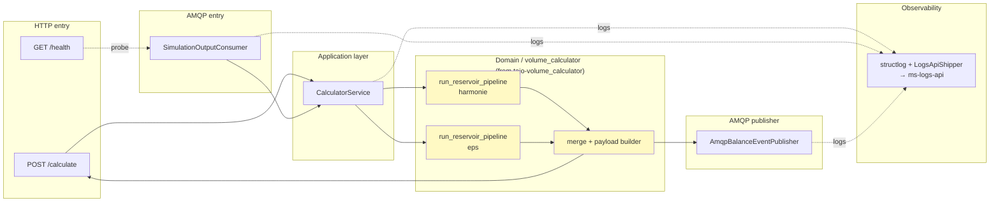

# ms-calculator-api

Microservicio **Python 3.12 + FastAPI** que calcula el **balance de volumen** de los embalses del río Tajo a partir de los outputs del modelo hidrológico (HARMONIE + EPS). Vive como el hop intermedio del pipeline de **simulación manual** entre `ms-model-api` (que fetchea el output del proveedor) y `ms-predictions-api` (que persiste las predicciones).

- **Puerto**: `3011`
- **Stack**: Python 3.12 · FastAPI · aio-pika · pydantic v2 · pandas · structlog
- **Stateless**: sin DB, sin cache. Todo el estado vive en el payload de entrada.

## Contexto: de un script CLI a una API HTTP+AMQP

Este servicio **NO reimplementa** la matemática del balance. El pipeline pandas original del equipo hidrológico está en el repo [`tajo-volume_calculator`](https://github.com/VSADTajo/tajo-volume_calculator) — se integra **verbatim** dentro de `src/domain/volume_calculator/` y se ejecuta desde una capa aplicativa (`src/application/calculator_service.py`).

### Layout del bridge

```
tajo-volume_calculator (repo externo, CLI Python)
    │
    │  volume_calculator/
    │  ├── reservoir_timeseries.py     ← run_reservoir_pipeline()
    │  ├── location_parameters.py
    │  └── __main__.py                 ← python -m volume_calculator ...
    │
    │  config/reservoir_parameters.json
    │
    ▼   (copiado verbatim en el bootstrap del servicio)
    │
ms-calculator-api/
├── src/
│   ├── domain/
│   │   └── volume_calculator/         ← el paquete completo, sin modificar
│   │       ├── reservoir_timeseries.py
│   │       ├── location_parameters.py
│   │       └── __main__.py
│   │
│   ├── application/
│   │   └── calculator_service.py      ← el "adapter": llama run_reservoir_pipeline
│   │                                    y publica el resultado por AMQP
│   ├── api/
│   │   └── routes/
│   │       └── calculate.py           ← POST /calculate wraps el mismo pipeline
│   ├── infrastructure/
│   │   ├── amqp/                      ← consumer + publisher (aio-pika)
│   │   ├── payload_source.py          ← adapter del payload AMQP al shape que espera el pipeline
│   │   └── logging/                   ← structlog + shipper a ms-logs-api
│   └── config/
│       ├── settings.py                ← pydantic-settings
│       └── reservoir_parameters.json  ← config del calculator (mapping reservoir→parameterId)
└── tests/
    └── integration/
        └── test_calculator_pipeline.py  ← contract test byte-identical vs golden output
```

**Invariante**: si `tajo-volume_calculator` publica una versión nueva del pipeline, se copia entera reemplazando el contenido de `src/domain/volume_calculator/`. El `test_calculator_pipeline.py` valida byte-identical output contra una golden fixture — si cambia la matemática, el test rojo lo captura.

### Qué agrega la API sobre el script CLI

El script original resuelve `run_reservoir_pipeline(config_path, reservoirs, pipeline)` cargando datos desde disco (patrones de archivo `input_data/*.json`). La API cambia el **origen de los datos** (`ports.PayloadSource`) para leerlos desde el payload AMQP/HTTP en vez del filesystem — todo lo demás (matemática, agregación, formato de output) es idéntico.

```python
# Script original:
python -m volume_calculator.reservoir_timeseries --pipeline harmonie
# Lee input_data/*.json del disco.

# API:
POST /calculate  → payload en el body
AMQP consumer    → payload en el message body
                  ↓
                 Adapter (payload_source.py) construye la misma shape que
                 el pipeline espera, y el pipeline no sabe que la fuente cambió.
```

## Fórmula del balance

Para cada embalse (locationId) y cada instante `t` del forecast, la calculadora computa:

```
v.balance(t) = max( 0,
                    v.obs.t0
                  + q.in.accumulated(t)     // integrado desde t0
                  - q.out.accumulated(t)    // integrado desde t0
                  )
```

- **`v.obs.t0`** — volumen observado del embalse en `t0` (inicio del forecast). En `hm³`. Se obtiene de la serie `v.obs` del payload (por embalse).
- **`q.in.accumulated(t)`** — caudal de entrada acumulado desde `t0`, en `hm³`. Se obtiene integrando la serie `q.in.for.*` (`m³/s`) sobre el tiempo: `Σ (valor × Δsegundos) / 1_000_000`.
- **`q.out.accumulated(t)`** — idem para el caudal de salida.
- **`max(0, ...)`** — el balance no puede ser negativo.

El pipeline se corre **dos veces por simulación**:

- **Modo `harmonie`** (determinista): 1 serie output → `v.balance.q.in.for.harmonie`
- **Modo `eps`** (probabilístico): 5 series output → `v.balance.q.in.for.eps.{10, 25, 50, 75, 90}`

Merge por `(reservoir, timestamp)` → **6 series output por embalse** en el payload de resultado.

## Reservoir → parameterId mapping

El archivo [`src/config/reservoir_parameters.json`](./src/config/reservoir_parameters.json) mapea cada embalse a los `parameterId` que espera encontrar en el payload de entrada:

```json
{
  "reservoirs": {
    "E_08": {
      "v.obs": "VICT01.Validado",
      "q.in.for": {
        "harmonie": "I.mk11.forecast",
        "eps": {
          "10": "I.mk11.EPS10forecast",
          "25": "I.mk11.EPS25forecast",
          "50": "I.mk11.EPSforecast",
          "75": "I.mk11.EPS75forecast",
          "90": "I.mk11.EPS90forecast"
        }
      },
      "q.out.for": "Q.salida.forecast"
    }
  }
}
```

Si el proveedor cambia los IDs, se actualiza este JSON — no hay que tocar código.

## Contratos

### AMQP (consumer)

- **Exchange**: `simulation-events` (topic, durable)
- **Routing key**: `simulation.manual.output.fetched`
- **Queue**: `calculator-simulation-manual-output`

Publica `ms-model-api` con envelope NestJS: `{ pattern: <routingKey>, data: <payload> }`. El consumer desenvuelve automáticamente.

**Payload esperado** (ver [`../docs/examples/simulation-output-example.json`](../docs/examples/simulation-output-example.json)):

```typescript
{
  simulationId: string;          // uuid v4
  providerName: "manual-simulation";
  seriesCount?: number;
  eventsCount?: number;
  timeSeries: Array<{
    header: {
      locationId: string;        // e.g. "E_08"
      parameterId: string;       // e.g. "VICT01.Validado"
      moduleInstanceId?: string;
      stationName?: string;
      missVal?: string;          // e.g. "-999.0"
      units?: string;
      timeStep?: { unit: string; multiplier: string };
      forecastDate?: { date: string; time: string };
      startDate?:    { date: string; time: string };
      endDate?:      { date: string; time: string };
      // extra fields allowed (pydantic ConfigDict extra="allow")
    };
    events: Array<{
      date: string;               // YYYY-MM-DD
      time: string;               // HH:MM:SS
      value: string;              // numeric string
      flag: string;               // "2" valid, "8" missing
    }>;
  }>;
}
```

### AMQP (publisher, success)

- **Routing key**: `simulation.manual.balance.computed`
- **Headers**: `{ 'x-simulation-id': <simulationId> }`

Payload:

```typescript
{
  simulationId: string;
  providerName: "volume-calculator";
  seriesCount: number;
  eventsCount: number;
  computedAt: string;             // ISO-8601 UTC
  timeSeries: Array<{
    header: {
      type: "instantaneous";
      moduleInstanceId: "volume_calculator";
      locationId: string;
      parameterId:                // one of:
        "v.balance.q.in.for.harmonie" |
        "v.balance.q.in.for.eps.10" | ".25" | ".50" | ".75" | ".90";
      units: "hm3";
      /* ...timeStep, dates, missVal, etc. */
    };
    events: Array<{ date, time, value, flag }>;
  }>;
}
```

También envuelto en `{ pattern: routingKey, data: payload }` (formato NestJS AMQP transport).

### AMQP (publisher, failure)

- **Routing key**: `simulation.manual.balance.failed`

Payload:

```typescript
{
  simulationId: string;
  providerName: "volume-calculator";
  reason: string;
  errorType: "invalid_payload" | "config_error" | "computation_error" | "publish_error";
  retryable: false;
  occurredAt: string;             // ISO-8601 UTC
}
```

### HTTP

- **`POST /calculate`** — mismo shape que el AMQP consumer, respuesta sincrónica con el balance calculado. Útil para debug y tests.
- **`GET /health`** — `200 {status:"ok", checks:{amqp:"ok"}}` cuando el broker es alcanzable; `503 {status:"degraded"}` si no.
- **`GET /docs`** — Swagger UI autogenerado.
- **`GET /openapi.json`** — schema OpenAPI.

Ejemplo:

```bash
curl -X POST http://localhost:3011/calculate \
  -H 'content-type: application/json' \
  -d @path/to/payload.json | jq .timeSeries[0].header.parameterId
# "v.balance.q.in.for.harmonie"
```

## Arquitectura interna (hexagonal-lite)



**Key files**:

| File | Role |
|---|---|
| `src/api/routes/calculate.py` | HTTP handler for `POST /calculate` |
| `src/api/routes/health.py` | Health check + AMQP probe |
| `src/api/schemas/simulation_input.py` | Pydantic model for input payload |
| `src/api/schemas/balance_output.py` | Pydantic model for output payload |
| `src/application/calculator_service.py` | Orchestrator: pipeline + publisher |
| `src/application/ports.py` | Abstractions (publisher, clock) |
| `src/infrastructure/amqp/consumer.py` | AMQP consumer + envelope unwrap |
| `src/infrastructure/amqp/publisher.py` | AMQP publisher + envelope wrap |
| `src/infrastructure/amqp/registry.py` | Topic/queue names |
| `src/infrastructure/payload_source.py` | Adapter payload → pipeline input |
| `src/infrastructure/logging/structlog_config.py` | JSON logs + contextvars |
| `src/infrastructure/logging/logs_api_transport.py` | Fire-and-forget shipper to ms-logs-api |
| `src/domain/volume_calculator/` | The original pandas pipeline, verbatim |
| `src/config/reservoir_parameters.json` | Reservoir → parameterId mapping |
| `src/config/settings.py` | Pydantic-settings (env vars) |

## Quickstart

```bash
# 1. Start shared infrastructure (RabbitMQ must be running)
cd infra && docker compose up -d

# 2. Start the calculator service
cd ms-calculator-api
cp .env.example .env
docker compose up -d

# 3. Verify health
curl http://localhost:3011/health
# {"status":"ok","checks":{"amqp":"ok"}}
```

## Development (no Docker)

```bash
cd ms-calculator-api
python -m venv .venv && source .venv/bin/activate
pip install -e .[dev]
cp .env.example .env
uvicorn src.main:app --host 0.0.0.0 --port 3011 --reload
```

## Testing

```bash
# Unit tests (no Docker needed) — 84 tests, ~2s
pytest tests/unit -v

# Integration tests (requires Docker for testcontainers)
pytest tests/integration -v

# E2E HTTP tests (in-memory FastAPI TestClient)
pytest tests/e2e -v

# All tests + coverage
pytest -v --tb=short
```

**Contract test importante**: `tests/integration/test_calculator_pipeline.py` corre el pipeline original con un fixture y compara el output byte-a-byte contra `tests/fixtures/expected_balance_output.json`. Si algún día se re-copia una versión nueva del script y cambia la matemática, este test se rompe y hay que actualizar el golden output (o rechazar el cambio).

## Environment variables

| Variable | Default | Description |
|----------|---------|-------------|
| `APP_NAME` | `ms-calculator-api` | Service name (used in logs) |
| `APP_PORT` | `3011` | HTTP port |
| `APP_LOG_LEVEL` | `info` | `debug` / `info` / `warning` / `error` |
| `NODE_ENV` | `local` | `local` / `development` / `production` |
| `RABBITMQ_HOST` | `127.0.0.1` | RabbitMQ host |
| `RABBITMQ_PORT` | `5672` | AMQP port |
| `RABBITMQ_USER` | `guest` | Username |
| `RABBITMQ_PASSWORD` | `guest` | Password |
| `RABBITMQ_VHOST` | `/` | Virtual host |
| `RABBITMQ_PREFETCH` | `10` | Consumer prefetch count |
| `RESERVOIR_CONFIG_PATH` | `src/config/reservoir_parameters.json` | Reservoir mapping file |
| `HEALTH_AMQP_TIMEOUT_MS` | `1000` | Health probe timeout |
| `LOGS_API_URL` | `""` | e.g. `http://ms-logs-api:3004`. Empty disables shipping (stdout only) |
| `X_API_KEY` | `""` | API key for ms-logs-api (`x-api-key` header) |

## Manual smoke test (end-to-end via AMQP)

```bash
# Publish a valid payload via NestJS-envelope (what ms-model-api produces)
SIM_ID=$(uuidgen | tr 'A-Z' 'a-z')
PAYLOAD=$(cat tests/fixtures/simulation_output_e08_e09.json)
ENVELOPE=$(jq -n --arg sim "$SIM_ID" --argjson data "$PAYLOAD" \
    '{pattern:"simulation.manual.output.fetched", data:$data}')

docker exec infra-rabbitmq rabbitmqadmin --vhost=/ \
    publish \
    exchange=simulation-events \
    routing_key=simulation.manual.output.fetched \
    payload="$ENVELOPE" \
    properties="{\"headers\":{\"x-simulation-id\":\"$SIM_ID\"}}"

# The calculator picks it up, computes, publishes balance.computed within seconds.
# Verify via container logs:
docker logs --tail 20 ms-calculator-api | grep "$SIM_ID"
```

## Spec / Plan / Tasks

- [spec.md](.specify/specs/calculator-integration/spec.md) — user stories + acceptance criteria
- [plan.md](.specify/specs/calculator-integration/plan.md) — arquitectura decisions
- [tasks.md](.specify/specs/calculator-integration/tasks.md) — TDD task list
- [clarifications.md](.specify/specs/calculator-integration/clarifications.md) — decisions bin

## Related documentation

- Flujo end-to-end de simulación manual: [`../README.md`](../README.md) sección "Simulation flows"
- Contrato del provider externo: [`../docs/examples/README.md`](../docs/examples/README.md)
- Runbook operacional: [`../docs/runbooks/manual-simulation-runbook.md`](../docs/runbooks/manual-simulation-runbook.md)
- Estándar de logs + correlation IDs: [`../docs/logging-standard.md`](../docs/logging-standard.md)
- Convenciones observability + DLX: [`../.claude/rules/08-observability.md`](../.claude/rules/08-observability.md)
